<div align="justify">

#### 4.2.2. Sprint 2

El segundo sprint desarrolla la coordinación entre ganaderos y veterinarios mediante observaciones, vinculaciones y visitas. El incremento Android integra estos recorridos con el backend y permite al ganadero consultar las visitas programadas por su veterinario. También incorpora la baja lógica de animales y continúa la integración de cuentas e inventario iniciada en el sprint anterior.

##### 4.2.2.1. Sprint Planning 2

El objetivo es que ambos perfiles compartan la información autorizada del ganado y coordinen una visita. El alcance se relaciona con las historias asignadas al Sprint 2 en el Product Backlog.

| Elemento                       | Registro                                                                                                                                                           |
| ------------------------------ | ------------------------------------------------------------------------------------------------------------------------------------------------------------------ |
| Sprint #                       | Sprint 2.                                                                                                                                                          |
| Date                           | 2026-11-06.                                                                                                                                                        |
| Time                           | 08:30 PM.                                                                                                                                                          |
| Location                       | Reunión virtual por Discord.                                                                                                                                       |
| Prepared By                    | Equipo NOVATICK.                                                                                                                                                   |
| Attendees                      | Jorge Brayan Ayala Fernández / Johan Yonel León Morales / Richard Enrique Lozano León / Ghiou Justinn Mauricio Silva / Edgar Alexander Mauricio Montes Zamora.     |
| Sprint 1 Review Summary        | El informe anterior registra la landing publicada y avances de identidad e inventario en el backend. La integración móvil figuraba pendiente.                      |
| Sprint 1 Retrospective Summary | El seguimiento del incremento requiere mantener actualizados el informe y las evidencias junto con los cambios de implementación.                                  |
| Sprint 2 Goal                  | Permitir que un ganadero autorice a un veterinario para consultar sus animales y que una visita programada por este último pueda consultarse desde ambos perfiles. |
| Métrica de cumplimiento        | Una invitación aceptada habilita el vínculo y una visita conserva el mismo identificador en la agenda veterinaria y en las próximas visitas del ganadero.          |
| Sprint 2 Velocity              | Referencia de planificación: aproximadamente 31 puntos por sprint, según el Product Backlog. No corresponde a velocidad medida.                                    |
| Sum of Story Points            | 29 puntos planificados: US05, US06, US14, US15, US16, US17, US18, US07, US08 y SP02.                                                                               |

Las comprobaciones por API respaldan el recorrido principal. Los 29 puntos corresponden al alcance planificado; el estado de cada tarea se presenta en el Sprint Backlog.

##### 4.2.2.2. Aspect Leaders and Collaborators

La coordinación del Sprint 2 se distribuye entre gestión del ganado, vinculación veterinaria, visitas, validación funcional y documentación. Cada integrante asume el liderazgo de un aspecto y colabora en los demás, para compartir la revisión del incremento y evitar que una sola persona concentre todas las responsabilidades.

| Team Member                             | GitHub Username | Gestión del ganado | Vinculación veterinaria | Visitas y agenda | Validación funcional | Documentación del sprint |
| --------------------------------------- | --------------- | ------------------ | ----------------------- | ---------------- | -------------------- | ------------------------ |
| Ayala Fernandez, Jorge Brayan           | jorgeayaladev   | L                  | C                       | C                | C                    | C                        |
| León Morales, Johan Yonel               | TheCap213       | C                  | L                       | C                | C                    | C                        |
| Lozano Leon, Richard Enrique            | AikoLz          | C                  | C                       | C                | C                    | L                        |
| Mauricio Silva, Ghiou Justinn           | Justinn2006     | C                  | C                       | L                | C                    | C                        |
| Montes Zamora, Edgar Alexander Mauricio | Zenkit0         | C                  | C                       | C                | L                    | C                        |

L identifica al responsable de coordinar el aspecto y C al colaborador. La coordinación comprende organizar las tareas, reunir las observaciones y comunicar los resultados de la revisión.

##### 4.2.2.3. Sprint Backlog 2

Las tareas permiten gestionar el ganado y coordinar la atención mediante un vínculo autorizado. Los responsables coordinan su seguimiento de acuerdo con los aspectos de la matriz de colaboración. Los estados distinguen el avance de implementación del cierre de cada historia.

| User Story Id | Title                                   | Task Id | Title / Description                                                 | Estimation (Hours) | Assigned To | Status    |
| ------------- | --------------------------------------- | ------- | ------------------------------------------------------------------- | ------------------ | ----------- | --------- |
| US05          | Dar de baja a un animal                 | S2-T01  | Integrar la baja lógica y consultar el estado resultante.           | —                  | Jorge       | To-Review |
| US06          | Registrar observación sobre un animal   | S2-T02  | Registrar y recuperar las observaciones del animal.                 | —                  | Jorge       | To-Review |
| US14          | Enviar invitación de vinculación        | S2-T03  | Enviar la invitación al correo del veterinario.                     | —                  | Johan Yonel | To-Review |
| US15          | Responder invitación de vinculación     | S2-T04  | Procesar la respuesta y habilitar el vínculo aceptado.              | —                  | Johan Yonel | To-Review |
| US16          | Consultar invitaciones pendientes       | S2-T05  | Recuperar las invitaciones del veterinario autenticado.             | —                  | Johan Yonel | To-Review |
| US17          | Consultar vinculaciones activas         | S2-T06  | Consultar vínculos, ganaderos y animales autorizados.               | —                  | Johan Yonel | To-Review |
| US18          | Revocar acceso del veterinario          | S2-T07  | Integrar la revocación y comprobar la pérdida de acceso.            | —                  | Johan Yonel | To-Review |
| US07          | Programar visita veterinaria            | S2-T08  | Crear la visita sobre un animal del ganadero vinculado.             | —                  | Justinn     | To-Review |
| US08          | Consultar agenda de visitas y controles | S2-T09  | Recuperar la agenda y las próximas visitas del ganadero.            | —                  | Justinn     | To-Review |
| SP02          | Validar notificaciones en Android e iOS | S2-T10  | Investigar los requisitos y límites de notificación por plataforma. | —                  | Edgar       | To-do     |

To-Review identifica las tareas implementadas que continúan en revisión de aceptación. To-do identifica la investigación de notificaciones por plataforma.

##### 4.2.2.4. Development Evidence for Sprint Review

La implementación Android incorpora edición y baja de animales, observaciones, invitaciones, vinculaciones y visitas. El backend dispone de los servicios utilizados por estos recorridos. Los siguientes commits permiten localizar los cambios; las fechas corresponden a sus registros Git.

| Repository               | Branch  | Commit Id                                                                                                    | Commit Message                                                           | Commit Message Body | Committed on |
| ------------------------ | ------- | ------------------------------------------------------------------------------------------------------------ | ------------------------------------------------------------------------ | ------------------- | ------------ |
| anitec-mobile-app-kotlin | main    | [0bd45fd](https://github.com/upc-pre-202620-1acc0238-13980-Novatick/anitec-mobile-app-kotlin/commit/0bd45fd) | feat(livestock): edit and deactivate animals in Kotlin                   | —                   | 10/11/2026   |
| anitec-mobile-app-kotlin | main    | [4426451](https://github.com/upc-pre-202620-1acc0238-13980-Novatick/anitec-mobile-app-kotlin/commit/4426451) | feat(livestock): add rancher animal observations                         | —                   | 11/11/2026   |
| anitec-mobile-app-kotlin | main    | [a4a74cf](https://github.com/upc-pre-202620-1acc0238-13980-Novatick/anitec-mobile-app-kotlin/commit/a4a74cf) | feat(linking): integrate invitations and veterinary links for both roles | —                   | 11/11/2026   |
| anitec-mobile-app-kotlin | main    | [9c92f5f](https://github.com/upc-pre-202620-1acc0238-13980-Novatick/anitec-mobile-app-kotlin/commit/9c92f5f) | feat(visits): implement veterinary scheduling agenda and visit details   | —                   | 12/11/2026   |
| anitec-mobile-app-kotlin | main    | [47a29fd](https://github.com/upc-pre-202620-1acc0238-13980-Novatick/anitec-mobile-app-kotlin/commit/47a29fd) | feat(visits): connect rancher upcoming visits and read-only details      | —                   | 12/11/2026   |
| anitec-platform          | develop | [1bb9787](https://github.com/upc-pre-202620-1acc0238-13980-Novatick/anitec-platform/commit/1bb9787)          | feat(care): expose farmer upcoming visits                                | —                   | 12/11/2026   |

La revisión Android toma como referencia `main`, commit `7492073`. Las funciones clínicas en desarrollo fuera de esa referencia no forman parte del incremento evaluado.

##### 4.2.2.5. Testing Suite Evidence for Sprint Review

El repositorio Android contiene tests JVM de repositorios y ViewModels, junto con pruebas instrumentadas de Compose. El backend contiene pruebas de aceptación integral sobre PostgreSQL temporal. Se distinguen estas pruebas versionadas de las solicitudes ejecutadas contra Render durante la evaluación.

| Relación               | Archivos de pruebas                                               | Comportamientos cubiertos por el código de test                                                   |
| ---------------------- | ----------------------------------------------------------------- | ------------------------------------------------------------------------------------------------- |
| US05                   | AnimalMutationTest.kt                                             | Edición y baja de animales, validaciones y tratamiento de errores.                                |
| US06                   | AnimalObservationTest.kt, ObservationDateTest.kt                  | Registro de observaciones y tratamiento de fechas.                                                |
| US14-US18              | LinkingRepositoryTest.kt, LinkingViewModelTest.kt                 | Invitaciones, respuestas, vínculos, permisos y aislamiento de cuentas.                            |
| US07-US08              | VisitRepositoryTest.kt, VisitsViewModelTest.kt, VisitInputTest.kt | Programación, agenda, validación de entrada y respuestas del servicio.                            |
| Próximas visitas       | FarmerVisitRepositoryTest.kt, FarmerVisitsViewModelTest.kt        | Consulta de visitas del ganadero y actualización de estado de presentación.                       |
| Aceptación del backend | MvpFunctionalAcceptanceTests.java                                 | Recorridos integrados con componentes reales y base temporal, según la documentación del backend. |

Pruebas Android: [src/test](https://github.com/upc-pre-202620-1acc0238-13980-Novatick/anitec-mobile-app-kotlin/tree/main/app/src/test) y [src/androidTest](https://github.com/upc-pre-202620-1acc0238-13980-Novatick/anitec-mobile-app-kotlin/tree/main/app/src/androidTest). Pruebas del backend: [src/test](https://github.com/upc-pre-202620-1acc0238-13980-Novatick/anitec-platform/tree/develop/src/test).

| Repository               | Branch  | Commit Id                                                                                                    | Commit Message                                                                | Commit Message Body | Committed on |
| ------------------------ | ------- | ------------------------------------------------------------------------------------------------------------ | ----------------------------------------------------------------------------- | ------------------- | ------------ |
| anitec-mobile-app-kotlin | main    | [53777cb](https://github.com/upc-pre-202620-1acc0238-13980-Novatick/anitec-mobile-app-kotlin/commit/53777cb) | test(linking): cover contracts, account isolation and bilingual Compose flows | —                   | 11/11/2026   |
| anitec-platform          | develop | [bcc31f9](https://github.com/upc-pre-202620-1acc0238-13980-Novatick/anitec-platform/commit/bcc31f9)          | test(mvp): validate integrated backend acceptance flows                       | —                   | 06/11/2026   |

La suite versionada utiliza Kotlin/JUnit y Java/JUnit. La ejecución reportada en este sprint corresponde a las pruebas por API de la sección siguiente; no se presenta una nueva ejecución de la suite Android.

##### 4.2.2.6. Execution Evidence for Sprint Review

Se realizaron solicitudes contra `https://anitec-staging.onrender.com/api/v1/` con dos cuentas nuevas y datos identificados como QA. La verificación utilizó los códigos recibidos en los buzones de prueba. No se incluyen credenciales ni identificadores privados en las evidencias.

| Caso   | Operación                                                   | Resultado observado                                                                                            |
| ------ | ----------------------------------------------------------- | -------------------------------------------------------------------------------------------------------------- |
| S2-E01 | Registrar y verificar ganadero y veterinario.               | Registro 201, verificación 200 y correos recibidos para ambos perfiles.                                        |
| S2-E02 | Iniciar y cerrar sesión en ambas cuentas.                   | Respuestas 200 en ambos recorridos.                                                                            |
| S2-E03 | Crear y consultar finca.                                    | Creación 201 y recuperación de la finca en la lista.                                                           |
| S2-E04 | Registrar, consultar y editar animal.                       | Creación 201 y consultas y actualización 200; se recuperó el nombre editado.                                   |
| S2-E05 | Registrar y consultar observación.                          | Creación 201 y consulta 200.                                                                                   |
| S2-E06 | Dar de baja un segundo animal de prueba.                    | Respuesta 200 y consulta posterior con estado INACTIVO.                                                        |
| S2-E07 | Enviar, consultar y aceptar invitación.                     | Creación 201, consulta 200 y aceptación 200; vínculo activo.                                                   |
| S2-E08 | Consultar ganaderos y animales desde la cuenta veterinaria. | Respuestas 200 con el ganadero vinculado y su animal.                                                          |
| S2-E09 | Programar y consultar visita.                               | Creación 201; el mismo identificador apareció en la agenda veterinaria y en las próximas visitas del ganadero. |
| S2-E10 | Volver a iniciar sesión y consultar el animal.              | El nombre editado se conservó.                                                                                 |
| S2-E11 | Consultar sin clave staging o con una clave incorrecta.     | Rechazo 403.                                                                                                   |
| S2-E12 | Consultar recursos privados con clave staging y sin sesión. | Rechazo 401.                                                                                                   |

En el registro, `emailDelivery: UNCONFIRMED` indicó que el servidor no confirmaba la entrega en esa respuesta. Posteriormente se recibieron ambos correos y se completó la verificación. El reenvío solicitado antes del plazo permitido respondió 429 con `RESEND_COOLDOWN`.

Estas comprobaciones corresponden a la API y no incluyen pruebas de interfaz en Android ni entrevistas con usuarios.

### Android Execution Evidence

#### Perfil Ganadero:

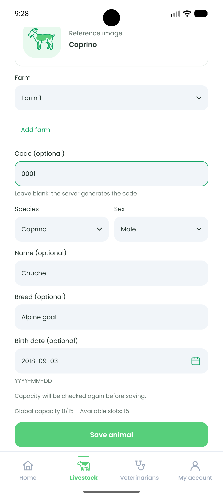

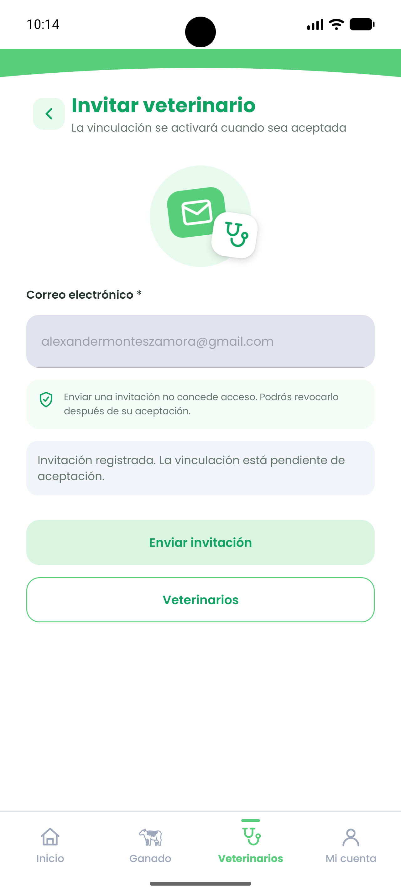

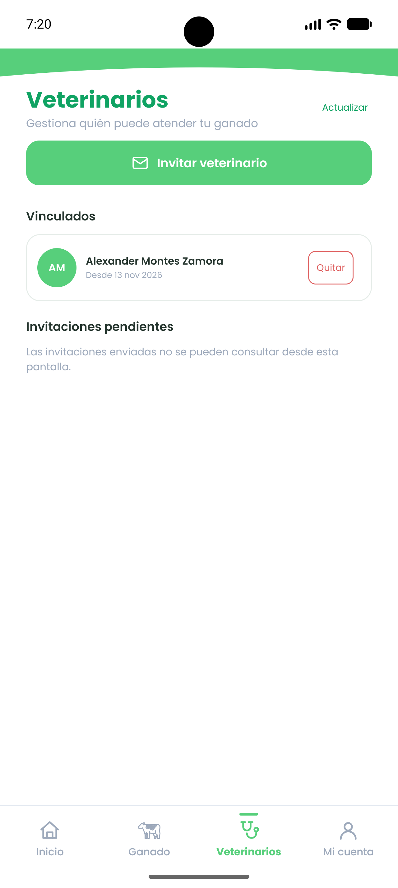

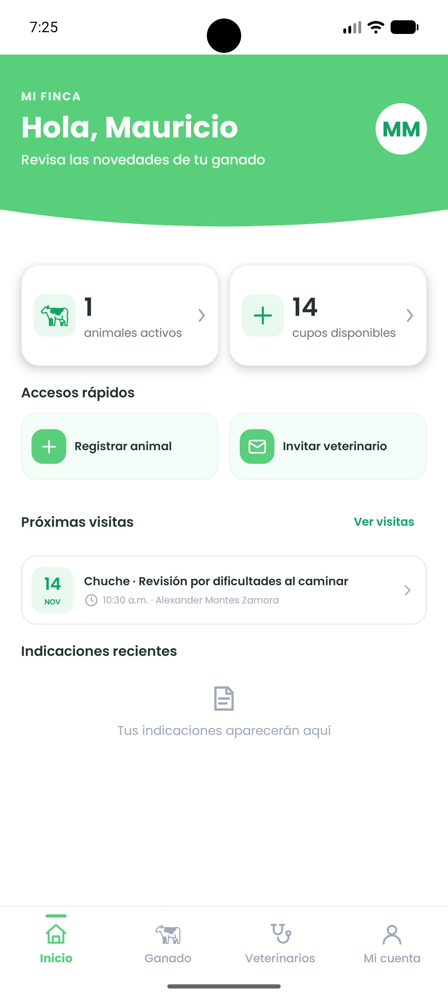

#### Perfil Ganadero:


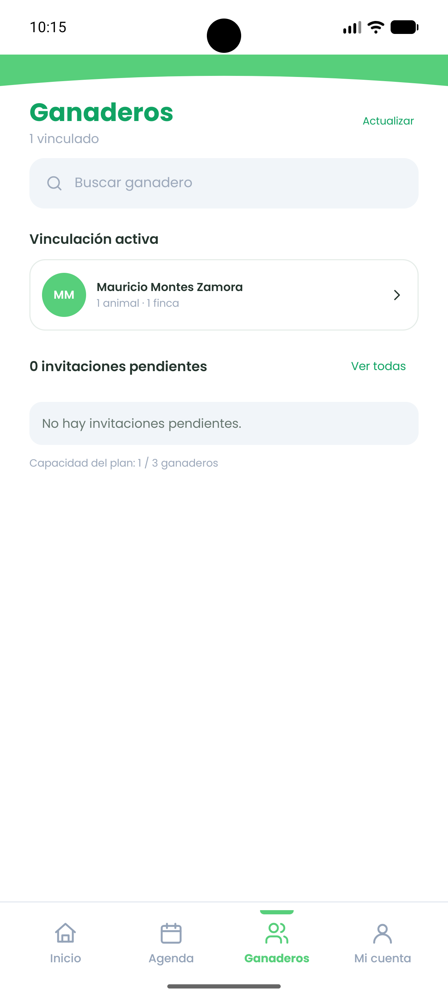

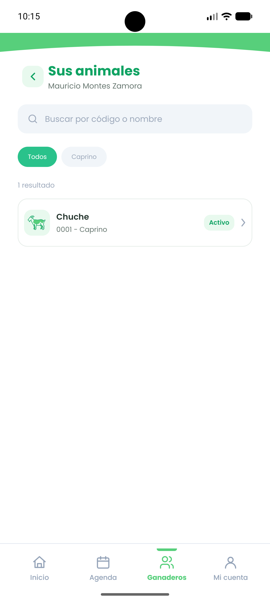

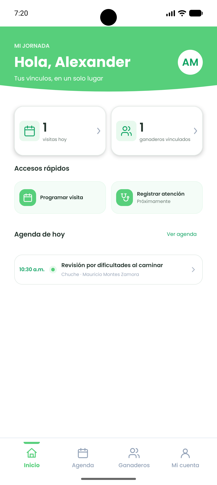

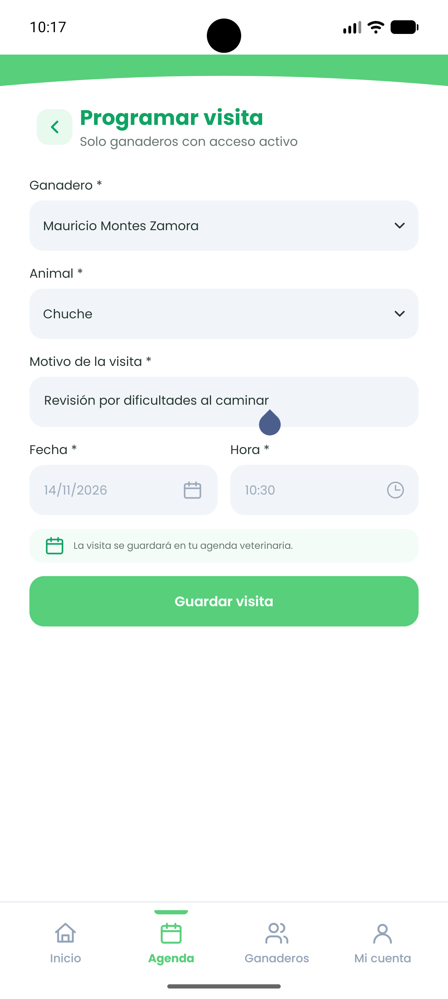

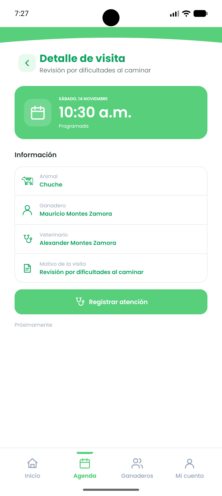

##### 4.2.2.7. Services Documentation Evidence for Sprint Review

El contrato OpenAPI del backend documenta las operaciones y respuestas del incremento. La documentación técnica se encuentra en [openapi.yaml](https://github.com/upc-pre-202620-1acc0238-13980-Novatick/anitec-platform/blob/develop/docs/api/openapi.yaml), acompañada por la [guía de integración móvil](https://github.com/upc-pre-202620-1acc0238-13980-Novatick/anitec-platform/blob/develop/docs/api/mobile-integration.md).

Las rutas siguientes son relativas a `/api/v1`. Las operaciones requieren JWT y, en staging, la clave de acceso privada.

| Historia              | Acción                     | Solicitud y parámetros                                                             | Respuesta de éxito                            |
| --------------------- | -------------------------- | ---------------------------------------------------------------------------------- | --------------------------------------------- |
| US05                  | Dar de baja                | DELETE `/animals/{animalId}`; UUID del animal en la ruta.                          | 200; identificador y estado resultante.       |
| US06                  | Registrar observación      | POST `/animals/{animalId}/observations`; cuerpo con `text`.                        | 201; observación creada.                      |
| US06                  | Consultar observaciones    | GET `/animals/{animalId}/observations`.                                            | 200; lista de observaciones.                  |
| US14                  | Invitar al veterinario     | POST `/invitations`; cuerpo con `vetEmail` y cabecera `Accept-Language`.           | 201; identificador y estado de la invitación. |
| US15                  | Responder invitación       | PUT `/invitations/{invitationId}/respond`; cuerpo con `action: ACCEPT` o `REJECT`. | 200; resultado de la respuesta.               |
| US16                  | Consultar pendientes       | GET `/invitations/pending`.                                                        | 200; invitaciones del veterinario.            |
| US17                  | Consultar vínculos         | GET `/vet-links` y GET `/vet-links/my-farmers`.                                    | 200; vínculos o ganaderos autorizados.        |
| US18                  | Revocar vínculo            | DELETE `/vet-links/{linkId}`.                                                      | 200; vínculo en estado REVOCADA.              |
| US07                  | Programar visita           | POST `/visits/schedule`; cuerpo con `animalId`, `scheduledAt` y `reason`.          | 201; visita creada.                           |
| US08                  | Consultar agenda           | GET `/visits?from={inicio}&to={fin}`; instantes ISO-8601 UTC.                      | 200; visitas del intervalo.                   |
| Consulta del ganadero | Consultar próximas visitas | GET `/visits/upcoming`.                                                            | 200; próximas visitas programadas.            |

Ejemplo de programación con datos ficticios:

```json
{
  "animalId": "11111111-1111-4111-8111-111111111111",
  "scheduledAt": "2030-06-01T15:30:00Z",
  "reason": "Control del animal"
}
```

La respuesta 201 contiene un sobre con `success`, `message`, `timestamp` y `data`. En `data` se recuperan el identificador de la visita, el animal, el ganadero, el tipo, la fecha programada, el estado y el motivo. Las consultas de agenda utilizan fecha y hora UTC; enviar únicamente una fecha no satisface ese contrato.

El commit [3b41173](https://github.com/upc-pre-202620-1acc0238-13980-Novatick/anitec-platform/commit/3b41173), del 06/11/2026, incorpora la documentación MVP y su referencia Swagger. El commit [1bb9787](https://github.com/upc-pre-202620-1acc0238-13980-Novatick/anitec-platform/commit/1bb9787) incorpora las próximas visitas del ganadero al contrato. La referencia de servicios presenta los modelos, parámetros y ejemplos de las operaciones.

###### Ejemplos de solicitudes y respuestas

Las siguientes capturas presentan los parámetros, cuerpos de solicitud y ejemplos de respuesta documentados para las operaciones del sprint.

**DS01. Baja de un animal**

Parámetro animalId y ejemplo de respuesta 200 para la baja lógica del animal.

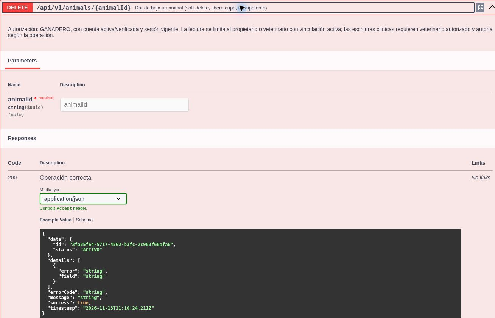

**DS02. Registro de observaciones**

Cuerpo de la solicitud y ejemplo de respuesta 201 de una observación.

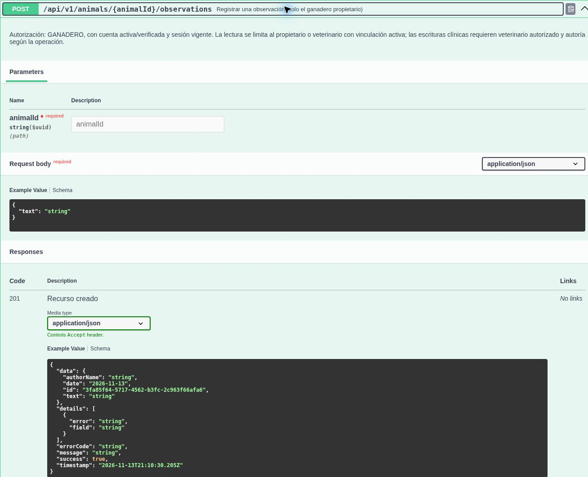

**DS03. Consulta de observaciones**

Identificador del animal y ejemplo de respuesta 200 con la lista de observaciones.

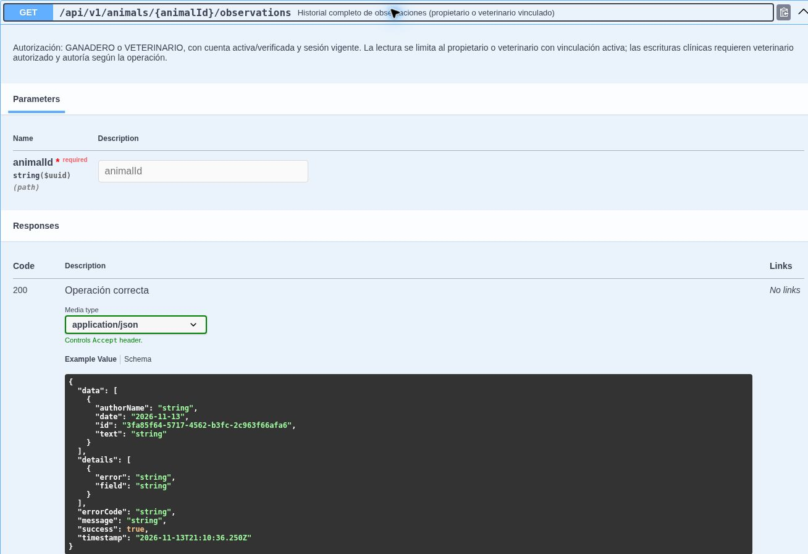

**DS04. Envío de invitación**

Correo del veterinario en la solicitud y ejemplo de respuesta 201 de la invitación.

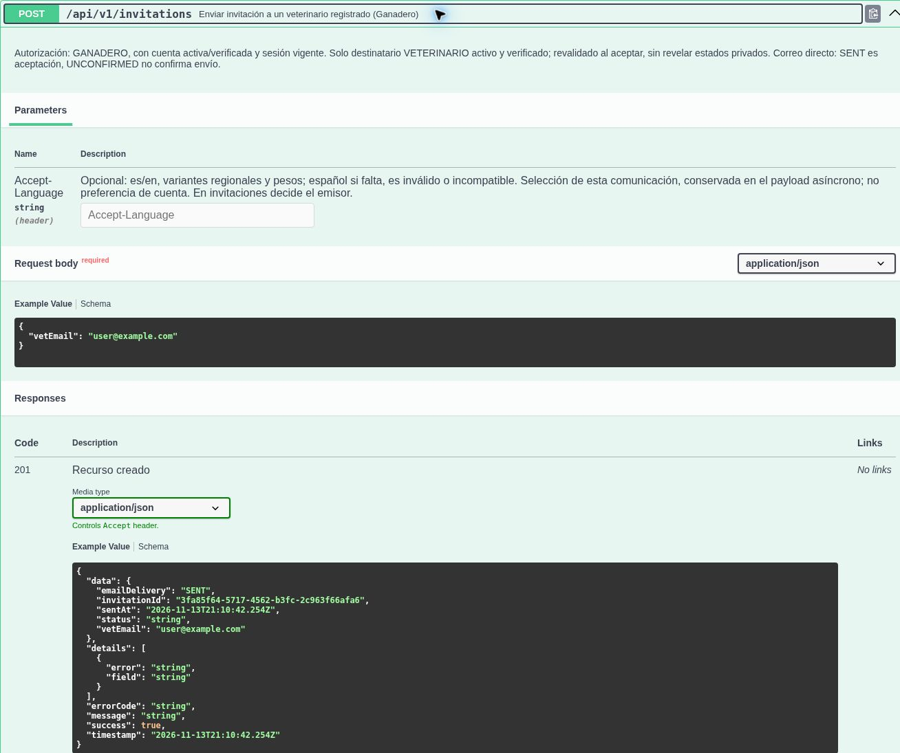

**DS05. Respuesta a una invitación**

Identificador y acción de respuesta a la invitación, junto con el ejemplo de respuesta 200.

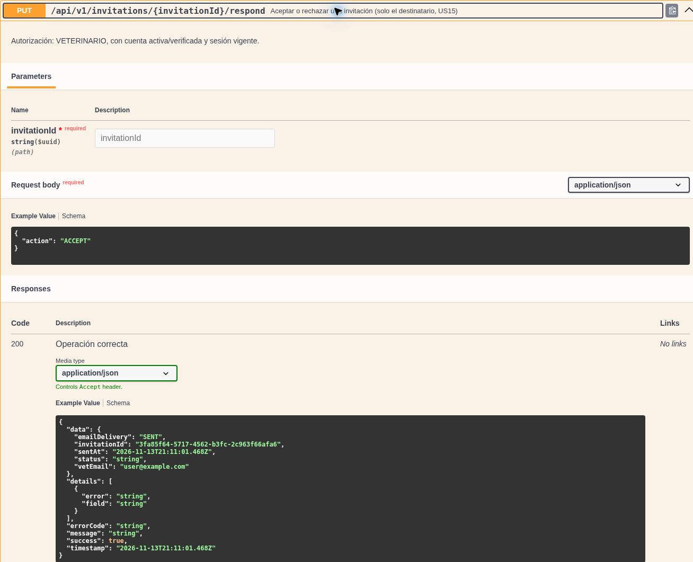

**DS06. Consulta de invitaciones pendientes**

Ejemplo de respuesta 200 con las invitaciones del veterinario.

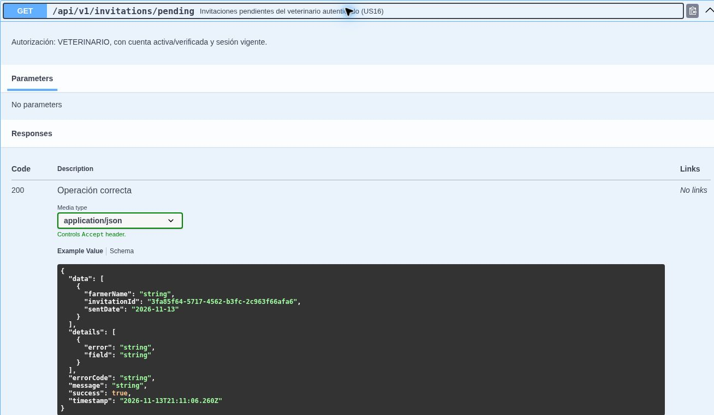

**DS07. Consulta de vinculaciones activas**

Ejemplo de respuesta 200 con el recuento y los datos de las vinculaciones.

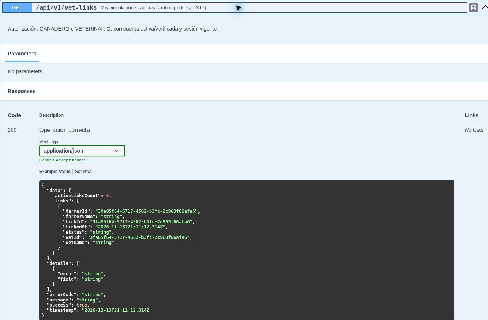

**DS08. Consulta de ganaderos vinculados**

Ejemplo de respuesta 200 con los ganaderos vinculados y sus fincas.

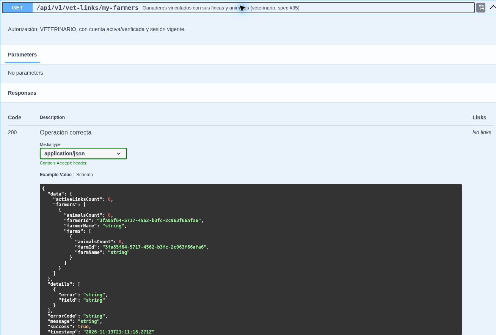

**DS09. Revocación de una vinculación**

Identificador del vínculo y ejemplo de respuesta 200 de la revocación.

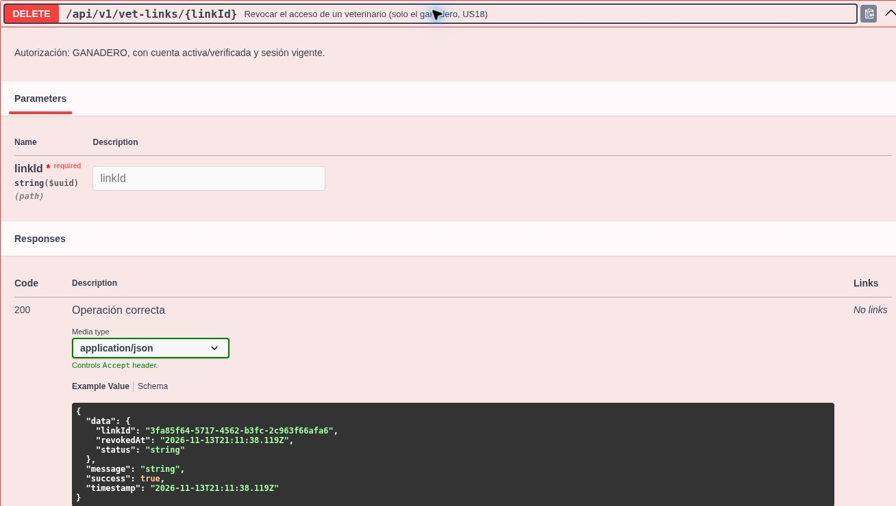

**DS10. Programación de una visita**

Cuerpo de la solicitud y ejemplo de respuesta 201 con los datos de la visita.

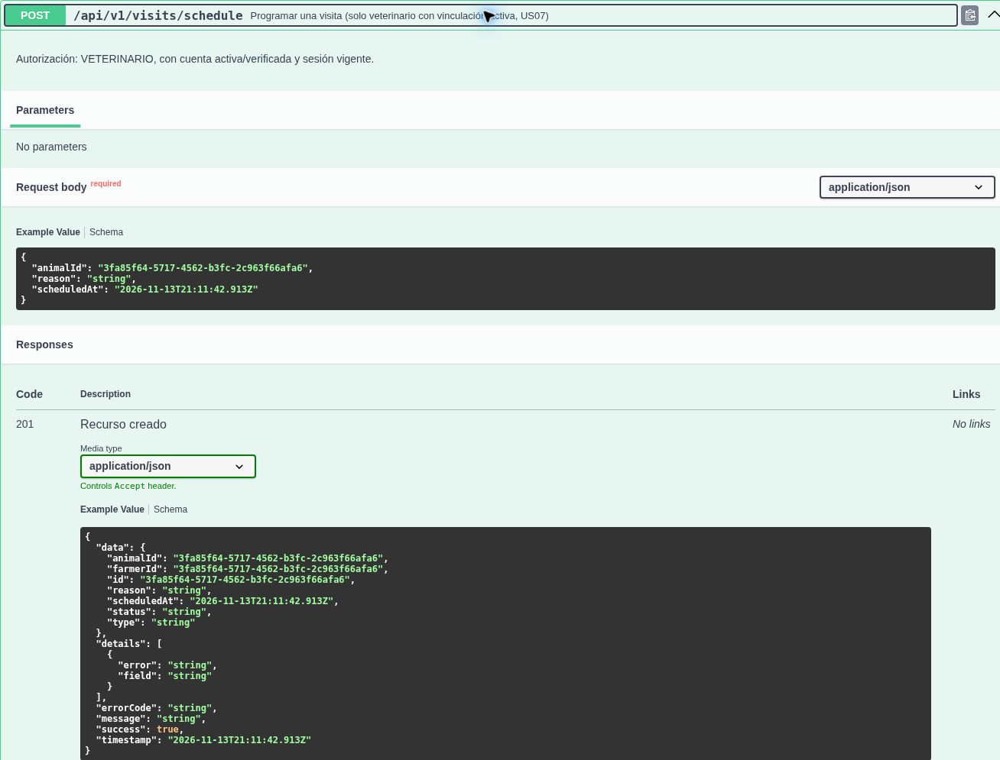

**DS11. Consulta de la agenda veterinaria**

Parámetros del intervalo y ejemplo de respuesta 200 de la agenda.

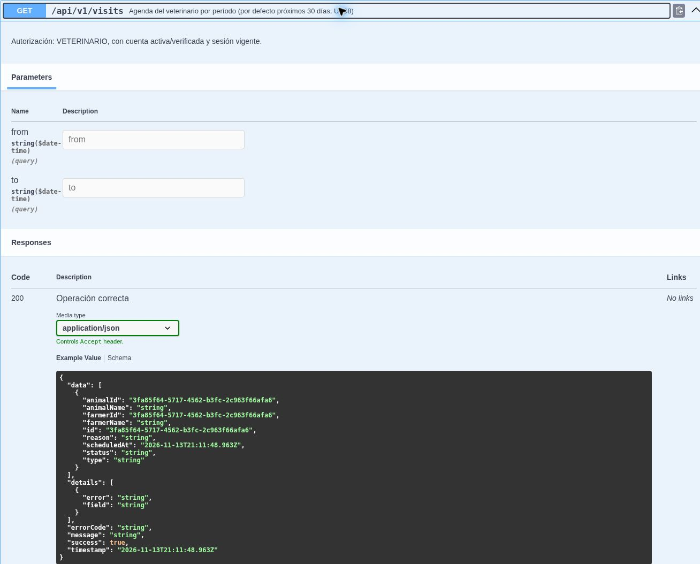

##### 4.2.2.8. Software Deployment Evidence for Sprint Review

La aplicación Android se evalúa desde `main` con la variante `alpha`, conectada al backend de staging. El README móvil describe la configuración y ejecución; la landing page conserva su publicación en GitHub Pages.

| Producto                           | Referencia                                                                                                           | Alcance de la evidencia                                                |
| ---------------------------------- | -------------------------------------------------------------------------------------------------------------------- | ---------------------------------------------------------------------- |
| Landing page                       | [ANITEC](https://upc-pre-202620-1acc0238-13980-novatick.github.io/anitec-website/)                                   | Publicación documentada en el Sprint 1.                                |
| Backend de evaluación              | [Render staging](https://anitec-staging.onrender.com)                                                                | Respuestas HTTPS y operaciones del recorrido comprobadas mediante API. |
| Android                            | [main](https://github.com/upc-pre-202620-1acc0238-13980-Novatick/anitec-mobile-app-kotlin/tree/main)                 | Código integrado y guía de ejecución de la variante alpha.             |
| Contrato y referencia de servicios | [Documentación API](https://github.com/upc-pre-202620-1acc0238-13980-Novatick/anitec-platform/tree/develop/docs/api) | Contrato, modelos y ejemplos documentados.                             |

La URL raíz de staging devuelve un rechazo de acceso cuando se consulta sin la cabecera privada. Ese resultado no implica que el servicio esté apagado. En las operaciones protegidas, la clave staging y la sesión cumplen funciones distintas. Las credenciales de infraestructura permanecen fuera del informe.

###### Despliegue del backend ANITEC en Render

Durante el Sprint 2, se consolidó el despliegue del backend de ANITEC en la plataforma Render, utilizando Java 21, Spring Boot y Docker. El entorno de staging permite que la aplicación móvil Android consuma los servicios REST mediante conexiones HTTPS, sin requerir la ejecución local del servidor.

El servicio `anitec-staging` se encuentra vinculado al repositorio `anitec-platform`, específicamente a la rama `develop`. Se realizó un despliegue manual del commit `4eb5018c51b6cc7df903e84ae9168b9a25e59708`, correspondiente a la integración de las funcionalidades de consulta de próximas visitas para el ganadero. El resultado fue satisfactorio y el servicio alcanzó el estado `Live`.

**DR01. Servicio backend desplegado en Render**

La siguiente captura evidencia la publicación del servicio `anitec-staging`, su vinculación con GitHub, la rama `develop`, el commit desplegado y la URL HTTPS asignada. Asimismo, permite verificar el estado operativo del backend.

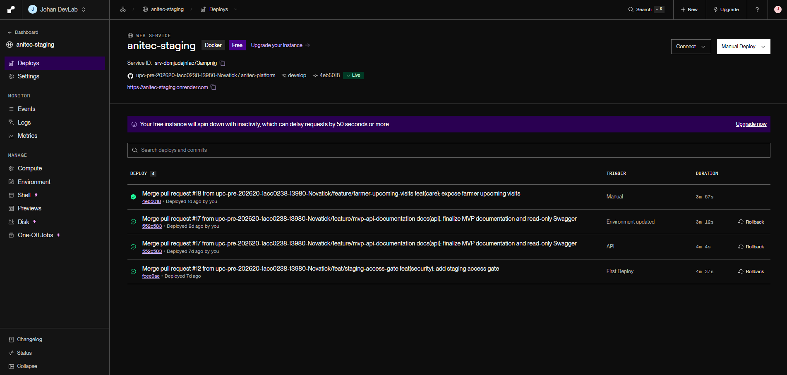

**DR02. Verificación del despliegue y ejecución del backend**

Para comprobar la ejecución del servicio, se revisó el historial del despliegue y los registros generados por Render. La plataforma confirmó que el despliegue manual finalizó correctamente el 12 de noviembre de 2026.

Los registros muestran el inicio de Spring Boot, la inicialización de los componentes de persistencia y la disponibilidad del servicio en su dirección pública. Esta evidencia confirma que el backend pudo iniciar satisfactoriamente en el entorno remoto.

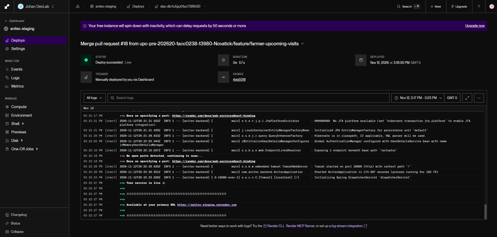

###### Persistencia de datos mediante PostgreSQL

El backend utiliza una instancia administrada de PostgreSQL denominada `anitec-staging-db`, alojada en Render. Esta base de datos permite almacenar la información generada durante las operaciones de autenticación, gestión ganadera, vinculaciones veterinarias y programación de visitas.

La instancia utiliza PostgreSQL 16 y se encuentra ubicada en la región Oregon (US West). Durante la revisión del entorno se verificó que su estado era `Available`, lo que evidencia la disponibilidad del servicio de base de datos para el entorno de staging.

**DR03. Disponibilidad de PostgreSQL en Render**

La siguiente captura presenta la configuración general y el estado de disponibilidad de la instancia PostgreSQL utilizada por el backend de ANITEC.

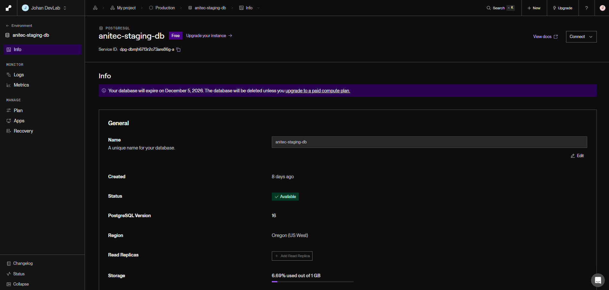

###### Monitoreo de recursos del entorno de staging

Render proporciona herramientas de monitoreo que permiten observar el comportamiento de los recursos utilizados por la base de datos. Durante el Sprint 2, se revisaron las métricas de memoria y CPU de PostgreSQL, con el propósito de contar con información sobre su utilización durante las pruebas realizadas.

Estas métricas permiten identificar tendencias de consumo y sirven como referencia para evaluar futuras necesidades de capacidad y optimización del entorno.

**DR04. Monitoreo de recursos de PostgreSQL**

La siguiente captura muestra los gráficos de utilización de memoria y CPU correspondientes a la instancia `anitec-staging-db`.

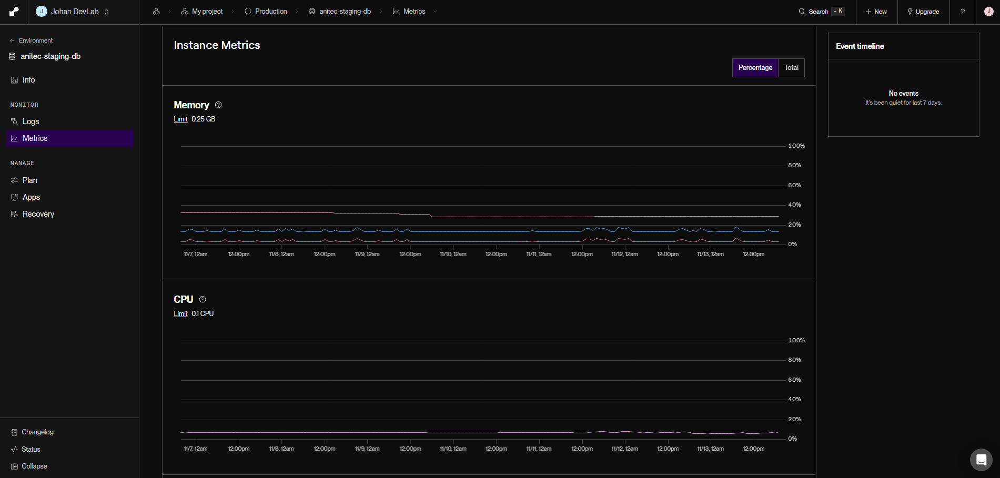

###### Validación del despliegue con la aplicación móvil

La integración entre el frontend Kotlin y el backend desplegado en Render fue comprobada mediante pruebas funcionales de los segmentos GANADERO y VETERINARIO. Entre las operaciones verificadas se encuentran el registro y autenticación de usuarios, la gestión de animales, el envío y aceptación de invitaciones, la vinculación veterinaria y la programación de visitas.

Asimismo, se confirmó que las visitas registradas por el veterinario podían consultarse desde la cuenta del ganadero correspondiente. Estas comprobaciones evidencian el funcionamiento integrado de los componentes principales del incremento desarrollado durante el Sprint 2.

El frontend Android fue publicado en la rama `main` del repositorio `anitec-mobile-app-kotlin`, bajo la etiqueta `v0.2.0-tb2`. Su variante `alpha` utiliza el backend desplegado en Render, manteniendo los mecanismos de autenticación y protección del entorno de staging.

En conclusión, el despliegue realizado permitió disponer de un entorno remoto de evaluación para ANITEC, integrando la aplicación móvil, los servicios del backend y la persistencia de información mediante PostgreSQL. Las evidencias presentadas respaldan la disponibilidad de los componentes desplegados y las pruebas funcionales efectuadas durante el Sprint Review.

##### 4.2.2.9. Team Collaboration Insights during Sprint

El historial permite seguir la separación de cambios de ganado, vinculación, visitas y documentación técnica. La integración móvil se encuentra en `main`; el backend actualizado se consulta en `develop`. No se atribuye el contenido de todos los commits a quien integra una rama: se distinguen la autoría del cambio y la operación de merge.

Las contribuciones pueden revisarse en los historiales de [Android](https://github.com/upc-pre-202620-1acc0238-13980-Novatick/anitec-mobile-app-kotlin/commits/main/) y [backend](https://github.com/upc-pre-202620-1acc0238-13980-Novatick/anitec-platform/commits/develop/). La actualización documental de Richard relaciona estos cambios con el Sprint 2 y con los resultados del recorrido de evaluación. La matriz distribuye la coordinación de la revisión y el cierre entre los cinco integrantes.

</div>
